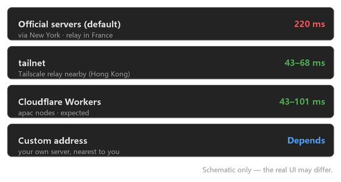

# PureRemote

**English** · [中文说明](#中文文档)

A free, portable, install-free remote desktop for Windows — a Qt6 shell around the
[RustDesk](https://rustdesk.com) 1.5.0 core. Think Sunlogin / ToDesk / AnyDesk, minus the
account, the installer and the price.

Three hard requirements drove the whole design:

* **Free** — every network path it offers costs nothing (RustDesk's public relay, your own
  Tailscale tailnet, or your own server).
* **Portable** — unzip and run. "Uninstalling" means deleting the folder; there is no
  installer and no service. The only intentional system write is an optional autostart
  registry value, off by default.
* **ID + password** — the familiar connection-code model: type the other computer's ID, type
  the password, press Connect.

The integration is at **process level**: PureRemote only drives `rustdesk.exe` through its
CLI and reads/writes RustDesk's own config files. It never links RustDesk's libraries, so
upgrading the core does not require rebuilding the shell.



## Honest status

Everything in this repository was verified on **one** Windows 10 machine. Please read this
table before trusting a feature:

| Area | State |
|---|---|
| Shell ↔ core integration, password modes, config rewriting, packaging | verified (17-check script) |
| Loopback session (this machine connecting to itself) | verified |
| **Two different computers over the internet** (P2P hole punching, relay fallback) | **not verified** — only one machine was available |
| Latency figures quoted below | single-machine / loopback measurements |

The verification script is honest by construction: steps that need a Tailscale authkey report
`SKIP` when none is supplied, and the summary line says explicitly that *skipped is not
passed*. It never prints an all-green summary it did not earn.

## Features

* **Connection UI** — one window, two groups: *this computer* (ID + password, with show /
  copy / regenerate) and *connect to another computer* (fill in the code and connect; no need
  to create an address-book entry first).
* **Address book** — optional shortcuts for machines you connect to often. The connection
  target is always what is typed in the box ("what you see is what you connect to").
* **Five password modes** — see the table below. Includes *rotate on a timer*,
  *expire after a deadline*, and *rotate after someone has connected and left*.
* **Four network paths** — public relay, your own tailnet, Cloudflare Workers, or any
  `host:port`; switchable at runtime, transactionally (all keys written or none).
* **Quality / performance settings** — codec preference and quality knobs written to
  RustDesk's per-peer config.
* **Keeps the controlled side alive** — the shell itself starts the windowless RustDesk
  server on launch and restarts it if it disappears, judging "is it alive?" by an actual
  `--server` command line rather than by process name (RustDesk's own UI process is *also*
  called `rustdesk.exe` but serves nothing).
* **Tray icon, autostart, bilingual UI** (Chinese / English), and a built-in illustrated
  guide that does not require a browser.
* **Health check** — a self-check panel that tells you what is missing and what the
  consequence of each missing item is (for example: "nobody can connect to this machine
  right now").

### Network paths

| Mode | What it does | Notes |
|---|---|---|
| **Official servers** | nothing to configure | default; measured ≈220 ms signalling from China, falls back to a New York / France relay when hole punching fails |
| **tsnet bridge** | a small Go helper (`pmrelay.exe`) joins both ends to a Tailscale tailnet | no admin rights, no TUN/WinTUN driver; measured ≈54 ms vs ≈184 ms through the official relay |
| **Cloudflare Workers** | point the core at your own hbbs/hbbr | you deploy it; `locationHint` must be `apac` to land in Hong Kong / Japan |
| **Custom address** | any `host:port` (frp, port forwarding, …) | simplest if you already own a server |

Why not just install the official Tailscale client? Because Windows has no built-in TUN
device: any software that hands the machine an IP must ship `wintun.sys`, and installing a
kernel driver always requires administrator rights. `tsnet` is Tailscale's official
userspace Go library — it exposes the tailnet to the calling process without touching a
driver. The price is one extra helper process.

### Password modes

| Mode | Behaviour |
|---|---|
| **Off** | no fixed password; only RustDesk's one-time password (nobody can get in without it) |
| **Fixed** | one password, until you change it |
| **Rotate** | a new password every N hours |
| **Timed** | the password expires at a deadline and is cleared |
| **Rotate after use** | same fixed password, but it is rotated once somebody has connected and disconnected |

The shell never claims a change it did not make: the *"not applied yet"* marker appears
whenever the value on disk disagrees with the mode you selected, and applying a password
requires stopping and restarting RustDesk (2–4 seconds of downtime, existing sessions are
dropped — the confirmation dialog says so).

## Layout of a portable build

```
PureRemote/
├─ PureRemote.exe       the shell
├─ qt.conf              Qt plugin path (required, or nothing starts)
├─ plugins/             Qt platform / style / image-format plugins
├─ bin/
│   ├─ rustdesk.exe     the core itself (thin shim, must sit next to librustdesk.dll)
│   ├─ librustdesk.dll  ~40 MB core
│   └─ pmrelay.exe      tsnet bridge (written for this project, userspace only)
└─ config/
    └─ puremote.json    shell configuration (created on first run)
```

The `rustdesk.exe` shipped in a build is the **unpacked real binary**, not the 25 MB
self-extracting launcher — the launcher unpacks ~80 MB into `%LOCALAPPDATA%\rustdesk\` on
first run, which is both slow and the one thing that would break the "nothing is installed"
promise.

**Portability has a boundary worth knowing:** the shell writes nothing to system folders, but
the *core* keeps this computer's identity (`enc_id`, `key_pair`, `salt`) in
`%APPDATA%\RustDesk\config\`. Copy the folder to another machine and it will register a
**new ID** unless you move that directory too.

## Build

```bash
# MinGW toolchain + Qt must be on PATH *before the first configure* — windres bakes the
# paths into the generated ninja rules.
export PATH="<Qt>/Tools/mingw1310_64/bin:<Qt>/6.8.3/mingw_64/bin:$PATH"
cd <source dir>
cmake --build --preset release
```

`CMakePresets.json` contains machine-local absolute paths and is therefore not tracked; copy
`CMakePresets.json.example` and fill in your own Qt and Ninja paths.

## Package

```powershell
powershell -File scripts\deploy.ps1 -Smoke
```

Produces `dist/PureRemote/` (~156 MB) and `dist/PureRemote.zip` (~64 MB). `-Smoke` really
launches the packaged exe and grabs a screenshot, because the classic portable-build failure
is a broken Qt plugin path, whose only symptom is *"no Qt platform plugin could be
initialized"* at startup.

`scripts/deploy.ps1` also contains machine-local paths and is not tracked; start from
`scripts/deploy.ps1.example`.

## Verification

```bash
bash scripts/verify.sh        # 17 steps
```

The suite covers the single-instance hand-off, "zero system writes", the address book, the
password modes, the connection-command construction, the watchdog's `--server` judgement,
headless render checks, the UI wiring (the one test that instantiates a real `MainWindow`),
the i18n tables, and packaging hygiene. It exits non-zero unless all 17 pass; the two steps
that need a Tailscale authkey are skipped and labelled as skipped.

## Privacy and security

* **No telemetry, no analytics, no phone-home.** The shell makes no network requests of its
  own; all traffic is RustDesk's.
* **The fixed password lives in plain text** at the top level of `RustDesk.toml` — that is
  the form RustDesk itself accepts (`validate_password_storage`'s legacy branch), and it is
  why the shell can show it back to you. It is stored where RustDesk stores its own config;
  it is never sent anywhere by the shell.
* **On first run the shell takes over the fixed password** (backing the old file up to
  `RustDesk.toml.bak` first), so that a freshly unzipped copy is reachable instead of
  silently locked. Later runs respect whatever you chose, including "no password at all".
* **The only intentional system write** is the optional autostart value in
  `HKCU\Software\Microsoft\Windows\CurrentVersion\Run` — off by default, removed when you turn
  the switch off, and only that one value is ever touched.
* Config files are edited byte-wise and in place: line endings are preserved, non-UTF-8 files
  are refused rather than rewritten, and a failed write rolls back to the original bytes.

## License and third-party components

* The code in this repository (the shell, the helper tools, the scripts) is **MIT** — see
  [LICENSE](LICENSE).
* The **RustDesk core is not part of this repository** (binaries are git-ignored) and is
  licensed **AGPL-3.0** by its authors. `bin/README.md` explains how to fetch and unpack the
  version this shell targets. A *packaged* build bundles that core, and anyone redistributing
  such a build must comply with RustDesk's licence.
* Not affiliated with, endorsed by, or supported by the RustDesk project.

---

## 中文文档

自建远程桌面的 **Qt6 外壳**，内核用 [RustDesk](https://rustdesk.com) 1.5.0。

目标是向日葵 / ToDesk / 网易UU 的替代品，三条硬要求：**免费、免安装、有 ID+密码的连接码**。

集成方式是**进程级**的：外壳只调 `rustdesk.exe` 的 CLI、读写它的配置文件，不链接任何库。
所以 RustDesk 升级换版本基本不影响外壳，也不需要跟着重新编译。

### 目录

```
PureRemote/
├─ PureRemote.exe       外壳
├─ qt.conf              Qt 插件路径（缺了起不来）
├─ plugins/             Qt 平台/样式/图片格式插件
├─ bin/
│   ├─ rustdesk.exe     内核真身（薄壳，必须与 librustdesk.dll 同目录）
│   ├─ librustdesk.dll  40MB 内核
│   └─ pmrelay.exe      tsnet 桥接（自写 Go，纯用户态）
└─ config/
    └─ puremote.json    外壳配置（首次运行生成）
```

**卸载 = 删文件夹。** 没有卸载器，这是刻意的：既然全程不装服务、不用管理员，
就不该有卸载器；而且卸载脚本一旦写错会删掉别人整个目录。

（唯一的例外是**开机自启**：那个开关会在 `HKCU\...\CurrentVersion\Run` 里写一条值，
默认关着、关掉就删、只动自己那一条。见下面「开机自启」一节。）

⚠ **"便携"的边界**：外壳本身一个字节都不写系统目录，但**内核不归外壳管** ——
RustDesk 把本机身份（`enc_id` / `key_pair` / `salt`）存在 `%APPDATA%\RustDesk\config\`。
所以**把整个文件夹复制到另一台机器，连接码不会跟着过去**，那台新机器会重新注册一个新 ID。
要迁移身份得连 `%APPDATA%\RustDesk\` 一起搬。

顺带一提：随包的 `rustdesk.exe` 是**解包后的真身**（369KB 薄壳 + 40MB `librustdesk.dll`），
不是 25MB 的自解包 launcher。用 launcher 的话第一次运行会当着用户的面解包到
`%LOCALAPPDATA%\rustdesk\`，冷启动多等好几秒 —— 直接发真身就没这回事。
（`cliExePath()` 靠"同目录有没有 `librustdesk.dll`"来区分两者，比按大小猜稳。）

### 构建

```bash
export PATH="<Qt>/Tools/mingw1310_64/bin:<Qt>/6.8.3/mingw_64/bin:$PATH"
cd <源码目录>            # ⚠ 路径必须纯 ASCII，中文路径下 moc 会失败
cmake --build --preset release
```

`export PATH` 必须在**第一次 configure 之前**做 —— MinGW 的路径会被 `windres` 烤进 ninja 规则，
之后再改不生效。

### 打包

```powershell
powershell -File scripts\deploy.ps1 -Smoke
```

产出 `dist/PureRemote/`（约 156 MB）和 `dist/PureRemote.zip`（约 64 MB）。
`-Smoke` 会真启动一次打包出来的 exe 并抓图，用来验证 Qt 平台插件真的能加载 ——
**绿色包最经典的翻车点**就是插件路径没配对，表现是一启动弹 "no Qt platform plugin"。

`scripts/deploy.ps1` 含本机 Qt 路径，所以没入库（`.gitignore`），模板见 `deploy.ps1.example`。

### 验收

```bash
bash scripts/verify.sh        # 十七项
```

十七项全绿才算过。其中两项要 Tailscale authkey（`TS_AUTHKEY` 环境变量或配置里的
`tsnet_authkey`），没给会 SKIP —— **跳过不等于通过**，脚本结尾会这么说。

第 16 项 `--paneltest` 是全项目**唯一**会真造一个 `MainWindow`（不 `show()`）的测试，
从真控件上读按钮状态、标签页数量、设置框高度。它存在的理由写在
[MainWindow.h](src/MainWindow.h) 的注释里：纯函数能把规则测得很透，但拦不住
**规则全对、喂给规则的输入是错的**。实际死过的那个 bug 正是如此（见下）。

### 连接别的电脑

**填码直接连**，不需要先"新建联系人"：在「对方连接码」里填对方的 ID，旁边有「粘贴」；
有固定密码就填「对方密码」（右边「显示」能看一眼自己填错没有）。填完点「连接」即可 ——
密码留空的话 RustDesk 自己会弹窗问。

地址簿的定位是**存过的常用设备**，不是连接的前置条件：想留着下次用再点「存到列表」，
选中列表里一条时那个按钮变成「保存修改」。所以**一条联系人都没有也能连上任何一台机器**，
连接目标是**输入框里显示的东西**（所见即所连），跟列表里选中的那条没关系。

⚠ 这里踩过一个把整组做成死路的 bug：按钮使能条件原来是"列表里有没有选中"，而「新建」
做的事正是**取消选中**。于是冷启动进来一个人也加不进、一个也连不上。现在使能规则抽成了
纯函数 [ConnectPanel.h](src/ConnectPanel.h)（`save` 只看输入框合不合法，与选没选中无关），
并且由 `--paneltest` 从真控件上读 —— 当年纯函数测试是绿的，**绿的规则配上错的输入，
照样死**。

### 界面

主界面只剩「本机」和「连接别的电脑」两组，其余全在两个 modeless 对话框里：

- **设置**分三页：`线路与画质`、`别人连我`（密码策略 / 有人连进来时）、
  `界面`（语言 / 开机与后台）。
  第一页**故意不叫「连接」** —— 它跟"连谁"无关，叫「连接」会跟主界面那组「连接别的电脑」
  撞名，让人以为重了一份。（主界面的「换线路…」打开的就是这一页，是快捷入口不是第二份。）
  原来五组一字排开，实测 580×1061 —— 比 1080p 屏的可视高度还高，底部的「关闭」和整组
  「界面语言」直接落在屏幕外面，而且**全程没有滚动条**。分页后是 502px。`--paneltest` 的
  P16 钉着"≤900px"，因为这种错**没有任何一条断言看得见**（截图只存 PNG 不做判断）。
- **教程**左侧是目录列表。原来是下拉框，四个主题的标题都很长（"自建服务器（自己的 VPS /
  frp / 端口映射）"），一个下拉里看不全；而且默认落地页本身又是一张"该选哪档"的卡片列表，
  等于同一件事让人选两遍。

主界面顶部有一行 **「线路：官方服务器 · 中继」**，旁边就是「换线路…」。网络档位原来只躺在
设置里、还挂着"进阶，一般不用改" —— 很多人根本不知道有这个选择，官方服务器一慢就直接判
"这软件不行"。现在把**当前走哪条**摆到最上面。

⚠ **窗口宽度是跟着内容算的，不写死。** 主界面在 QScrollArea 里，而横条是
`ScrollBarAlwaysOff` —— 内容比窗口宽**不是出滚动条，是被直接切掉**（最右边那列
「粘贴 / 显示 / 复制」就落在屏幕外，用户实机报了这条）。宽度取自内容的最小宽度，并且在
`LayoutRequest` 上重量一次 —— 挂在那个事件上而不是每个 `updateXxx()` 里各塞一遍调用，
是因为宽度取决于**文案**和**某个控件亮没亮**（隐藏的控件不计入布局最小宽），而改这两样
的地方散在好几个函数、每个内部还有好几处 `return`，漏掉的那个就是下次"右边又被切了"。
只涨不缩（文案变短时把用户正看着的窗口缩一下没有任何好处）。英文串普遍比中文长一大截
（那行 `Replace it with one shell can remember`），`--paneltest` 的 **P46 专门另开一个
英文档窗口**把这条钉住 —— 语言是构造时 `TR()` 求值烤进控件里的，只量中文那半会漏掉
英文档（已经漏过一次）。

⚠ 那行的直连/中继颜色取自 NetworkProbe 信号里的 bool，**不是**在文案里找「直连」两个字 ——
切到英文之后文案里就没那两个字了，颜色会静默退回中继色（不报错、界面看着也正常，
只是判断反了）。

### 四档网络路径

设置里「连接」页的**「线路」**组切换，写入 `RustDesk2.toml` 的 `[options]`。四档都免费。

| 档位 | 做什么 | 适用 |
|---|---|---|
| **官方服务器** | 什么都不用配 | 默认。但国内实测信令 220ms，**打洞失败退回纽约/法国中继**，体验差 |
| **tsnet 桥接** | 自写 `pmrelay.exe` 把两端接进 tailnet | 免管理员（纯用户态，不装 wintun 驱动）。实测中继在香港 **54ms vs 官方 184ms** |
| **Cloudflare Workers** | 自建 hbbs/hbbr | 要自己部署；`locationHint` 必须设 `apac` 才落到香港/日本 |
| **自填地址** | 任意 `host:port`（frp / 端口映射） | 已经有服务器的话最省事 |

切换是**事务性**的：一组键要么全写要么全不写，失败整体回滚。恢复官方档 = 清空这七个键。

⚠ tsnet 档需要 Tailscale 账号（免费档 `$0`、设备不限）并生成 authkey。**没有匿名模式。**

#### 为什么不能用 Tailscale 官方客户端

Windows 内核没有内置 TUN 设备，任何能给机器发 IP 的软件都必须自带 `wintun.sys`，
而**装内核驱动在 Windows 上永远需要管理员** —— 这是操作系统的安全边界。
`tsnet` 是 Tailscale 官方 Go 库，纯用户态，把 tailnet 暴露给调用方进程，不碰驱动。
代价是要多跑一个 `pmrelay.exe`。

### 密码

写 `RustDesk.toml` 顶层的**明文** `password` 字段。

`--password` CLI 在便携模式下会被拒（要"已安装 + 管理员"），但配置文件路径完全绕开了这个限制：
认证侧对非加密存储**回落明文校验**（`src/server/connection.rs` 的 legacy plaintext 分支），
所以明文能用。全程不需要管理员。

⚠ **改 `RustDesk.toml` 必须按括号深度判作用域**，不能用"行首是不是 `[`"判表头 ——
文件里 `key_pair = [[...]]` 是多行数组，会被误判切开。**写坏 TOML 的后果是 RustDesk
静默丢弃 `enc_id`/`key_pair` 重新注册，ID 会被换掉。** 所以所有改写都是
"备份 → 深度感知改写 → 复验 → 失败回滚"。

#### 开箱即用：首次运行自动补一个固定密码

绿色包默认是「关闭」档（不设固定密码）。但 RustDesk 的一次性密码**读不出来** ——
命令行只有 `--get-id` / `--set-id` / `--config`，没有"把临时密码打印出来"这条路
（已 grep `librustdesk.dll` 确认）。也就是说开箱之后**这台机器谁都连不进来**，
而且用户在这个界面上连临时密码是多少都看不到。所以**第一次运行时会自动接管固定密码**，
生成一个显示在主界面上（能看能复制）。

⚠ 顺带说清**代价**：如果这台机器的 RustDesk 里**原本就有一个**固定密码（它只存密文，
外壳读不出内容，也没法读出来），首次运行会**把它替换掉** —— 原来那个立刻失效，
写之前自动备份到 `RustDesk.toml.bak`。这是刻意的取舍：不换的话，新用户第一次打开看到的
就是「已设置（外壳看不到）」加上一个要人做选择的按钮，**大多数人看不懂**（用户实机的原话）。
只发生一次 —— 落地成功后 `password_bootstrapped` 置位，之后永远走不到这条。

这一步是**写盘**，而且改的是别人的凭据，所以判据往死里窄 —— 只有这六项**全部**成立才动手：

| 条件 | 为什么 |
|---|---|
| 外壳配置文件**本轮启动时不存在** | 真·首次运行。判据落在**我自己的文件**上，不是别人的 |
| 还没记过"已经做过决定" | 用户主动选的「关闭」也是一次决定，不能被下次启动偷偷推翻 |
| 模式是 Off 或 Fixed | Rotate / Timed 各有自己的到点逻辑，不插手 |
| 外壳自己没有明文密码 | 有就别碰 |
| `RustDesk.toml` **存在** | 不存在时写不进去，是"还没到时候"不是"没有" → 转去重试（3 秒 × 5） |
| `RustDesk.toml` **读得到** | **读不到 ≠ 没有密码**。"不知道"就别动别人的东西 |

（最后一个条件 `顶层确实没有 password 行` 在 2026-10-10 被**去掉**了：它曾经是"别碰已有密码"
的护栏，代价是新用户第一次打开撞上的正是"已有加密密码"这个状态 —— 于是只能看着
「已设置（外壳看不到）」发呆。现在首次运行一律接管，这一项降级成**提示语用**的
（决定提示说"已经设好一个"还是"已经把原来那个换掉了"）。少了一个"去看别人的文件此刻写了什么"
的判据，反而把很久以前那次覆盖事故的路径从根上消掉了。）

**为什么"必须是自己文件不存在"这一条不能省**（真出过事）：判据一旦落到
"`RustDesk.toml` 里现在没有 `password` 这一行"上，就等于把**别人的文件在某一瞬间的内容**
当成了事实 —— 而 RustDesk 自己会在启动/退出时整份重写它，那一瞬间读到的可能正好是"没有密码"
（也可能读到写了一半的）。实测发生过：开发机跑验收时，外壳把用户原生的**加密**固定密码
当成"没有"，直接写了一个自己生成的新密码进去（原值在 `RustDesk.toml.bak` 里，已整份还原）。

同一个歧义还拆出了一个独立的探针 `RustDeskController::probePassword()`，返回
`{exists, readOk, hasPassword, raw}` —— `readPasswordRaw()` 返回空串**分不清**
"确实没设"和"读不到"，而这两件事的后果差得很远。

#### 现在没人能连进来 —— 这条警告

没有固定密码时，主界面顶部那条横幅会**转成红色**并明说后果（"现在没人能连进来：…"），
「本机」那一行的密码提示也变红。它跟别的缺项**不是一类**：别的只是"某个功能暂时用不了"，
这一项直接等于"这台机器谁都连不进来"，混在"还差 N 项：…"里读不出后果
（用户实机就是这么被绕进去的：连不上，回头看密码那栏才发现是空的）。

#### 密码的五个档位

设置 →「别人连我」→「密码策略」。前四档是"这个固定密码什么时候变"，第五档是"只认一次"。

| 档位 | 意思 | 代价 |
|---|---|---|
| **不用固定密码** | 谁也别用固定密码连进来，只认 RustDesk 自己的一次性密码 | ⚠ **这台机器谁都连不进来** —— 那个一次性密码只有 RustDesk 自己的窗口看得到，外壳读不到（见上）。这一档下界面会多一个「打开 RustDesk 看一次性密码」按钮，那是唯一的逃生口 |
| **固定密码** | 一直用同一个 | 忘了 / 泄露了就得手动换 |
| **定时轮换** | 到点换新密码 | 换的瞬间重启 RustDesk，几秒连不上 |
| **限时有效** | 到点作废 | 同上 |
| **用完即换** | 有人连过一次、**对方断开之后**自动换新密码 | 见下 |

##### 「用完即换」的时机是"人走了之后"，不是"有人连上来了"

这是用户要的"连一次就自动变"。实现上**不能**在"有人连上来"那一刻换 —— 换密码要
"停 RustDesk → 写文件 → 再拉起来"（第三方走不了它的 IPC，`stop()` 就是 `taskkill /F`），
在连接那一刻动手等于把刚连上的人掐断。

所以触发点取的是被控端日志里那条确凿的**会话结束**标记（`Connection closed:`），
那一刻对端已经走了，重启不伤任何人。再叠两条防抖：

- **10 秒宽限**：断开后 10 秒内对端又回来了（客户端网络抖一下就重连），说明人还在，**不换**。
- **30 秒下限**：距上次轮换不足 30 秒不换，免得反复掉线重连把 RustDesk 反复重启。

⚠ **已知边界**：日志里那条结束标记**不带对端 ID**（RustDesk 就没写）。所以"A 走了、B 立刻连上"
这种重叠场景，程序分不出来 —— 它会当成"走的那个人又回来了"而放弃本次轮换。宁可少换一次，
也不错杀一个正在连的人。

⚠ 它与「固定密码」互斥：不能同时要"永久密码"和"用完即换"。

#### 「未应用」那三个字

改了档位只是改了**外壳的意图**，机器上真正生效的还是 `RustDesk.toml` 里那个密码 ——
中间要按一下「立即应用」才落地。所以界面会在按钮旁边显示一个红字「**未应用**」，
判据是个纯函数（`PasswordPolicy::needsApply()`）：

| 情形 | 判定 |
|---|---|
| 非「不用固定密码」档，但文件里**没有**密码 | 未应用 |
| 非「不用固定密码」档，文件里那串**跟外壳记的对不上**（漂移） | 未应用 |
| 「不用固定密码」档，但文件里**还留着**密码（该删还没删） | 未应用 |
| 其余 | 已应用 |

以前没有这个标记的时候，界面可以显示着「关闭」而机器上那个固定密码**还在生效** —— 界面在说谎。

#### 「已设置（外壳看不到）」是怎么来的

RustDesk 只把固定密码存成**加密串**，外壳读不回明文（对端 exe 路径校验卡死了 IPC，读不回来）。
所以「本机」那一行可能显示「已设置（外壳看不到）」，并且「显示」/「复制」都是灰的 ——
这不是 bug，是**读不回来**。

⚠ **首次运行不会再撞上这个状态**（2026-10-10 起）：那一刻外壳会直接把密码接管成自己管的
那一个，主界面上开门见山地能看能复制 —— 见上面「开箱即用」那节。

会看到它的，是**跑过外壳之后又漂移出来的**少数情况（最典型：用户自己去 RustDesk 的原生窗口
里设了个密码）。这时唯一的路仍然是**换掉它**，入口只有**一个**：「设置 → 别人连我 → 立即应用」，
确认框会直说这是替换、旧密码立刻失效。换完之后这一行就显示可读可复制的新密码了。

（那条路上原来还挂着第二个入口 ——「本机」行上的「**换成外壳能记住的新密码**」按钮。
它删了：名字本身没人看得懂（"外壳能记住"是什么？），而且它偏偏出现在**第一次打开**的时候，
用户实机反馈就是「大部分人看不懂」。按钮没了，判据和确认框都还在，只是入口收了。）

同理，档位切到「不用固定密码」之后那个删除动作也会先问一遍 —— 它删的是一个凭据，
不能让用户从一句委婉的话里去猜。

#### 验收不会碰你的密码

`--pwtest` / `--poltest` 要真的清空、重写 `RustDesk.toml` 顶层那个 `password` 才验得了，
而那是这台机器上**唯一一份**固定密码 —— RustDesk 只存加密串，谁都读不回来，删了就真没了。
所以这两项跑的是**真文件的副本**（逐字节的真实内容，断言质量一点没降），
真文件在整个验收过程里一个字节都不会动；两项各自最后一条断言（`T16` / `P38`）
就是"真文件逐字节未变"。

以前不是这样：那时拿真文件跑、末尾再把原字节写回去。中间那段窗口里，你的密码处于
**不存在**的状态；进程一旦被打断（timeout 杀进程 / 崩溃 / Ctrl-C），写回就不会发生。
更坏的是下一次正常启动有一条判据是「toml 里没有 password」—— 于是它会**静默**补一个
机器生成的新密码，你既连不上、也拿不到新的。这不是推演：**2026-10-10 真发生过一次**，
文件里躺着一个 10 位明文，用户原来那串加密的没了（已按 `RustDesk.toml.bak` 整份还原，
md5 一致）。现在 `verify.sh` 第 5 步还会从**外面**再钉一道闸：整轮跑完真文件逐字节
必须没变 —— 代码以后退回老做法，当场红。

（同理还有 `puremote.json` / `RustDesk2.toml` 那几个会被测试改写的文件，它们仍然是
"真文件上跑、跑完写回"。没有一起挪去副本，是因为"毁掉"的性质不同：外壳自己的配置
每个字段我们手里都有一份，写回就是原字节；只有 `RustDesk.toml` 里那串密码是
**谁都读不回来**的。这里护的就是那一个不可恢复的东西。）

### 开机自启

设置 →「界面」→「开机与后台」→ 勾上「开机自动运行，起来只待在托盘里」。

写的是 `HKCU\Software\Microsoft\Windows\CurrentVersion\Run` 里 **一条** 值
（值名 `PureRemote`，数据是 `"<exe 绝对路径>" --tray`）。关掉开关就把那一条删掉，
只动自己写的那个，不需要管理员，不写 Program Files，不装服务。

⚠ **这是整个项目唯一一处有意为之的系统写入。** 默认**关闭**，只在用户点那个开关时才写；
启动流程、截图流程、`scripts/verify.sh` 的十七项一律不碰（第 4 步"零系统写入"照旧成立）。
真要验注册表那一来一回，手动跑一次 `--autostarttest`（15 项，只动自己那条值，跑完必定还原）
—— 它**故意不在**那十七项里，因为那批的前提就是零系统写入。

**几点实话：**

- **「登录后生效」**。Run 键是登录时才跑的。如果这台机器设了登录密码而人不在，
  开机之后**在你登录之前仍然连不进来**。界面上的提示就是这么写的，别指望"开机就能连"。
- **它只做一件事**：让外壳自己起来并待在托盘里（`--tray` 下**不弹窗**）。RustDesk 被控端
  仍由外壳的保活逻辑负责拉起（跟平时一样）。
- **挪了目录会自愈**。绿色软件被整个搬到别处是常态，注册表里那条还指着旧路径 ——
  启动时发现路径对不上就悄悄改写成当前路径。不带 `--tray` 的旧值也判为"要修"
  （那种值开机会弹窗口，不是"静默待连"）。
- 卸载不用管：它不装任何东西，删掉整个目录、把开关关一次（或手动删那条注册表值）就干净了。
  本项目**不提供卸载程序**。

### 被控端保活（为什么不能只看"进程名"）

绿色免安装没有开机自启的系统服务，人不在电脑前也没人去双击 RustDesk —— 所以被控端
（`rustdesk.exe --server`，无窗口）由外壳自己拉起、每 10 秒看一眼、掉了立刻重拉。

**"还在不在"不能按进程名判。** RustDesk **自己的界面进程也叫 `rustdesk.exe`**，而它
**不提供服务**：它只是 IPC 客户端，连不上服务端时每秒往
`%APPDATA%\RustDesk\log\tray\` 里刷一行
`ERROR [src\tray.rs:277] ipc connection closed: reset by the peer`。

2026-10-10 就是这么翻的车：服务端死了、只留下一个界面进程（用户点过「打开 RustDesk
看一次性密码」），而看门狗数的是"有没有叫 rustdesk.exe 的进程" —— 判成一切正常，
**一次都没拉**，机器静默变成谁都连不进来（在那台机器上连它自己都报「目标设备离线或
不存在」）。现场证据是 `log\tray\` 里那串每秒一行的报错，一路刷了几百行。

现在的判据是**命令行里那个独立的 `--server`**（`tasklist` 给不出命令行，所以问
`wmic process … get commandline /format:list`；新系统上 wmic 被移掉时退回 PowerShell 的
CIM）。两种"问不出来"都有明确处置：

- 两个查询**都没跑成**（工具被移掉 + 策略封了 PowerShell）→ 判**"还在"**。宁可少拉一次，
  也不能每 10 秒去起一个 `--server`：实测重复的 `--server` 会在 `\\.\pipe\RustDesk\query`
  上撞车、把**正在服务的那个**带走（2026-10-10 12:41 那次服务端死亡就是这么来的）。
- **只剩界面进程** → 判"不在"，照拉。这条就是 `--servertest` 的 S2，`verify.sh` 第 8 步
  还会真的造一遍现场：被控端进程全灭 → 只补一个 `--tray` → 看门狗必须把 `--server` 拉回来。

### 画质与性能

界面上「画质与性能」组：**画质档 / 自定义系数 / 帧率 / 编码器**，按联系人存。
画质档四选一，对应 RustDesk 的画质系数：省流 `low` = 0.5、**平衡 `balanced` = 0.67（默认）**、
清晰 `best` = 1.5、自定义 `custom` = 1.0（系数由"自定义值"那个 0–100 的滑块决定）。

⚠ **这些值不写在 `RustDesk2.toml` 里。** 往全局 `[options]` 写 `image_quality` /
`custom_image_quality` / `custom-fps` / `codec-preference` **完全无效** —— 做过两次独立的
自连 A/B，会话日志里的参数逐字节不变，跟什么都没写一样。真正生效的是**每个对端一份**的
`%APPDATA%\RustDesk\config\peers\<对端ID>.toml`（`image_quality` 与 `custom_image_quality` 在顶层，
`custom-fps` 和 `codec-preference` 在 `[options]` 段里）。

由此带来两条界面上的规矩：

- **只能改已经连过的联系人。** RustDesk 是在**第一次会话时**才建这个文件的；自己造的极简文件
  会被它在会话开始那一刻整个重置成默认。所以没连过的联系人在界面上是灰的，提示"先连一次再回来调"。
- **值由外壳自己校验。** RustDesk 收到 `image_quality='zzzbogus'` 照单全收、然后静默按默认档跑 ——
  不校验的话用户会以为设置生效了。非法值在外壳这一步就被挡下。

写入同样是事务性的（备份 → 改 → 复验 → 失败回滚），并且按括号深度判作用域 ——
peers 文件里有 `size = [\n 0,\n …]` 这种多行数组，用"行首是不是 `[`"判表头会把文件切成非法 TOML。

#### 改 RustDesk 的配置文件时的四条硬规矩

配置读写集中在 [RustDeskController.h](src/RustDeskController.h)（`readConfigBytes` /
`writeConfigBytes` / `detectEol` / `splitConfigLines`），`PeerPrefs` 也走这四个。都不是洁癖，
每一条都对应一个真实踩过的坑：

- **一律按字节读，不带 `QIODevice::Text`。** 它在 Windows 上会把 `\r` 剥掉。危险的地方不是它
  改了内容，而是**它让改动看不见**：写盘时若带上它，整份文件每一行都被写成 CRLF，而任何用带
  `Text` 的读函数做的比较都把 `\r` 吃掉、显示"一字未变"。一半的修复比不修更坏。
- **行尾按原文风格还回去。** 原文是 LF 就还是 LF，是 CRLF 就整份 CRLF（包括新插入的行），
  绝不混。`--qtest` 的 B21 和 `--proftest` 的 B4c 分别从两个方向钉这件事。
- **不是合法 UTF-8 就拒绝，不动它。** `QString::fromUtf8` 遇到坏字节会静默塞 U+FFFD，
  "读进来再写回去"等于把坏文件改得更坏 —— 而 `RustDesk.toml` 里是 `enc_id`/`key_pair`，
  写坏等于丢身份、**ID 被换掉**。
- **回滚用内存里那份原字节，不靠"先删再 copy 备份"。** 后者中间有个文件不存在的窗口：
  磁盘满 / 杀软锁 / 权限一失败，这份含身份的文件就真没了，而界面还平静地说"已回滚"。

⚠ 顺带记一个 Qt 的坑：`QStringDecoder::operator()` 返回的是**惰性代理**（`EncodedData`），
只有**转成 `QString` 的那一刻**才真解码。所以 `dec(bytes);` 这一行什么都不做 —— 能编译、
不报错、`hasError()` 永远 `false`，"检查 UTF-8"的守卫就变成了空操作。必须写成
`const QString s = dec(bytes);`。`--qtest` 的 B22（拿真·坏字节文件去撞）是唯一能看出来的办法。


### 已验证 / 未验证

**验证过**：M1 骨架与托盘、M2 地址簿与连接编排、M3 密码策略（含真停起轮换链路）、
M4 网络层（体检 / 四档映射 / 路径探测 / tsnet 桥接）、M5 绿色包、画质与性能（写盘位置 /
校验 / 事务语义）、一页式界面与图文教程、中英双语（399 条翻译，中英各抓图核对）、
密码五个档位与「用完即换」判据、开机自启（含真注册表一来一回）、被控端保活的判据
（`--servertest` 9 项纯解析，喂真机抓的 `wmic` 原文；第 8 步还真造一遍"服务端死了、
只剩界面进程"那个现场）。
`verify.sh` 十七项全绿（第 9、10 项的 authkey 与桥接闸门没给就 SKIP，**不冒充全绿**）。

「开箱即用」那两步单独说清楚**验到了什么**、**怎么验的**：

- **首次运行自动接管密码的六条判据**（`--poltest` 的 P5a-P5h）是**纯函数**逐条钉的，
  外加两个隔离实验（把 `APPDATA` 指到一个空的假目录，让 `configDir()` 落到假的 RustDesk
  配置上）：**跑过外壳的机器（外壳配置已在）→ 一个字不碰**、**真·全新机器 + 已有的加密密码
  → 确实接管**（写盘成功、原密码进 `RustDesk.toml.bak`、界面上那一行变成能看能复制）。
  两半都验到了。
  ⚠ 这个隔离只对**外壳**有效：`APPDATA` 环境变量是 Qt 这边读的，而 `rustdesk.exe`（Rust）
  走 `SHGetKnownFolderPath`，**不认这个环境变量** —— 所以实验里那个被拉起来的 RustDesk
  仍然读写真配置。实验只用来验"外壳做不做、写不写得到它自己那个目标路径"，
  别拿它去断言 RustDesk 那边的行为。
- **红色横幅与红色提示**（`--paneltest` 的 P26-P31）读的是**真控件**：造一个真 `MainWindow`
  （全程不 `show`，只读 `isEnabled()` / `styleSheet()` / 文本）。纯函数测试拦不住这一类 ——
  "规则全对，错的是界面喂给规则的输入"。
- **主界面宽度放不放得下**（`--paneltest` 的 P45/P46）：这两块是**唯二**真的 `show()` 一次
  再量的（量完立刻 `hide()`）—— 宽度是靠 `LayoutRequest` 撑起来的，没显示过的窗口收不到
  那个事件，构造期量到的数偏小。P46 还**另开一个英文档窗口**量（语言是构造时烤进去的，
  中途切 `I18n::setLang()` 不会重译已有控件）。这条断言验过会咬人：把
  `MainWindow::event()` 里那个钩子临时改成 `if (false && …)` 重跑，P46 立刻红
  （内容需要 771 px、窗口只有 628 px），改回来就绿。
- **`--shot-nopw`** 另存一张"没有固定密码"状态下的主界面截图，给人眼看红横幅长什么样。
- **开机自启的注册表一来一回**（`--autostarttest`，15 项，手动跑）：真写 `HKCU` 的 Run 键、
  再用**另一个进程** `reg query` 读回来确认（不拿同一个 API 复验自己）、路径漂移判据、
  带空格路径的引号、关掉之后值确实消失 —— 跑完按原状还原（本来关着就还是关着）。

⚠ 这一轮出过一次**真事故**，也照原样记在这里：外壳曾经把开发机上**用户原生的加密固定密码**
当成"没有密码"给覆盖掉了（判据当时落在"`RustDesk.toml` 此刻没有 `password` 行"上，而 RustDesk
自己会在启动/退出时整份重写那个文件，那一瞬间读到的不是事实）。原值在 `RustDesk.toml.bak` 里，
已按字节整份还原（md5 一致），并加了"必须是外壳自己的配置文件在本轮启动时都不存在"
这一条，让写盘路径在这台机器上**再也不可能**命中 —— 详见上面「开箱即用」那节。

**没验证过**（本机只有一台，跨机的事测不了）：

- **跨机 P2P 打洞**。日志里确实出现过 `Hole Punched`，但那是自己连自己、出口 IP 是本机自己的，
  **不能当证据**。
- **两台机器之间真的连上并操作**。所以"留空密码时 RustDesk 自己弹窗问密码"这条也没验过。
- **tsnet 跨机直连**。单机上两个 tsnet 节点会挑到一条走不通的假"直连"（本机 LAN 地址），
  所以桥接测试固定走中继（香港 hkg）。
- **画质档真能改出画质差异**。已证明的是"写到哪个文件、写得对、非法值被挡"，以及改完之后
  RustDesk 会话日志里确实读到新档位（`initial quality` 0.67 → 0.5）。但"人在另一台机器上看到的
  画面真的更清晰/更糊"要真会话，单机验不了。
- **「用完即换」的端到端效果**。它的**触发判据**（认出"对端断开"那条日志标记、排除
  RustDesk 自己的 `connection manager` 关停、日志轮转后不丢标记）是用真日志副本逐字节验过的
  （`--conntest` E 段），超时与防抖也是纯函数钉的；但"真的连一次、断开、密码就变了"
  需要一次真会话 —— 单机连自己也不构成一次真实的"对端断开"。
- **开机自启在**真·开机**时的效果**。注册表那条值的构造、写入、读回、漂移自愈、删除都验过了
  （`--autostarttest`），`--tray` 也实测过"只出托盘、不弹窗、不建任务栏幽灵缩略图"；
  但**重启一次机器看它自己起来**这件事没做过。

跨机验证需要第二台机器，目前只能如实记着。

### 被控端的环境设置

这几项跟远程体验直接相关，但都是系统设置、不是代码，需要人工改：

1. **插网线**。Wi-Fi（Intel AC 3165，1x1 入门卡）是远程体验头号杀手。
2. **关网卡省电**。WLAN 和以太网的"允许计算机关闭此设备以节约电源"默认是开的，
   不改会待机掉线。
3. **关屏超时改成 5–10 分钟**（现在是从不，白费电；关屏本身不影响抓屏）。
4. **合盖不休眠**。笔记本合盖默认睡眠，远程就断了。
