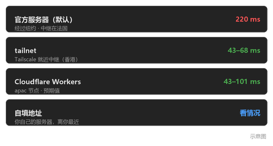

# Pure Remote 远程

**English** · [中文说明](#中文说明)

---

## English

### What it is

A free, portable, install-free remote desktop for Windows — a Qt6 shell around the
[RustDesk](https://rustdesk.com) 1.5.0 core. Think Sunlogin / ToDesk / AnyDesk, minus the
account, the installer and the price.

* **Built with** — C++17 / Qt 6 Widgets for the shell, RustDesk 1.5.0 as the remote-desktop
  engine, plus one small Go helper for the Tailscale network path.
* **How it integrates** — at **process level** only. The shell drives `rustdesk.exe` through
  its CLI and edits RustDesk's own config files; it links none of its libraries. Upgrading the
  core does not require rebuilding the shell.
* **Why use it** — no account, no installer, no background service, no administrator rights.
  "Uninstalling" means deleting the folder.


### Features

* **One-window connection UI** — *this computer* (ID + password, with show / copy /
  regenerate) and *connect to another computer* (type the code and press Connect).
* **Address book** — optional shortcuts for machines you connect to often. You never need an
  entry to connect: the target is always what is typed in the box.
* **Five password modes** — fixed, rotate on a timer, expire after a deadline, rotate after
  somebody has connected and left, or no fixed password at all.
* **Four network paths** — public relay, your own Tailscale tailnet, Cloudflare Workers, or
  any `host:port`; switchable at runtime.
* **Per-peer quality settings** — quality level, custom factor, frame rate and codec.
* **Keeps the controlled side alive** — the shell starts the windowless RustDesk server on
  launch and restarts it if it disappears.
* **Tray, optional autostart, bilingual UI** (Chinese / English), and a built-in illustrated
  guide that needs no browser.
* **Self-check panel** that says what is missing *and what the consequence is* — for example
  "nobody can connect to this machine right now".

### How it works

The shell never reimplements the remote-desktop protocol. It configures RustDesk and
supervises it.

**Network paths.** RustDesk talks to a rendezvous server to find the peer, then tries to punch
a direct connection and falls back to a relay.

| Mode | What it does | Notes |
|---|---|---|
| **Official servers** | nothing to configure | default; ≈220 ms signalling from China, and hole-punch failures fall back to a relay in New York / France |
| **tsnet bridge** | a small Go helper (`pmrelay.exe`) joins both ends to a Tailscale tailnet | no admin rights, no TUN driver; ≈54 ms vs ≈184 ms through the official relay |
| **Cloudflare Workers** | point the core at your own hbbs/hbbr | you deploy it; `locationHint` must be `apac` to land in Hong Kong / Japan |
| **Custom address** | any `host:port` (frp, port forwarding, …) | simplest if you already own a server |

Why not just install the official Tailscale client? Because Windows has no built-in TUN
device: any software that hands the machine an IP must ship `wintun.sys`, and installing a
kernel driver always requires administrator rights. `tsnet` is Tailscale's official userspace
Go library — it exposes the tailnet to the calling process without touching a driver. The
price is one extra helper process.

**Passwords.** RustDesk's `--password` CLI flag is refused in portable mode (it wants an
"installed" copy and admin rights), but the config file path bypasses that: the shell writes
a plain-text `password` at the top level of `RustDesk.toml`, which RustDesk still accepts
through its legacy plain-text branch. So a password can be set, read back and shown in the UI
— no administrator, no installer.

| Mode | Behaviour |
|---|---|
| **Off** | no fixed password; only RustDesk's one-time password (which the shell cannot read — it is only visible in RustDesk's own window) |
| **Fixed** | one password, until you change it |
| **Rotate** | a new password every N hours |
| **Timed** | the password expires at a deadline and is cleared |
| **Rotate after use** | same fixed password, but rotated once somebody has connected and disconnected |

Changing a password requires stopping and restarting RustDesk — about 2–4 seconds during which
the machine cannot be reached, and any live session drops. Where that matters, the UI says so
before doing it. The shell also never claims a change it did not make: a *"not applied yet"*
marker appears whenever the value on disk disagrees with the mode you selected.

**Staying reachable.** A portable app installs no service, and nobody is there to launch
RustDesk by hand, so the shell supervises the headless `rustdesk.exe --server` process and
relaunches it if it stops. Deciding whether it is alive is done by looking for the standalone
`--server` token in the process command line — **not** by process name, because RustDesk's own
UI process is *also* called `rustdesk.exe` and serves nothing.

### Performance

All figures below are from a single Windows 10 machine, so loopback and same-machine
measurements only:

| Measurement | Result |
|---|---|
| Relay latency, tsnet path via Hong Kong | ≈54 ms steady-state RTT |
| Relay latency, RustDesk official relay | ≈184 ms |
| Signalling latency to the official servers, from China | ≈220 ms |
| Portable build | ≈156 MB unpacked, ≈64 MB zipped |

### Getting started

There is no prebuilt download in this repository (it ships source only — the packaged build
would bundle RustDesk's AGPL binaries). Build it:

1. Get Qt 6.8 (MinGW) and Ninja.
2. `cp CMakePresets.json.example CMakePresets.json` and fill in your Qt and Ninja paths.
3. Build — see below.
4. Unpack the RustDesk 1.5.0 runtime next to the executable; `bin/README.md` explains how.
5. Run it. On first launch the shell sets a fixed password and shows it, so a freshly unzipped
   copy is reachable instead of silently locked.

### Build from source

```bash
# MinGW and Qt must be on PATH *before the first configure* — windres bakes the paths into
# the generated ninja rules. The source path must be pure ASCII: moc fails on non-ASCII paths.
export PATH="<Qt>/Tools/mingw1310_64/bin:<Qt>/6.8.3/mingw_64/bin:$PATH"
cmake --build --preset release
```

To produce the portable folder and zip:

```powershell
powershell -File scripts\deploy.ps1 -Smoke
```

`-Smoke` really launches the packaged executable and grabs a screenshot, because the classic
portable-build failure is a broken Qt plugin path whose only symptom is *"no Qt platform
plugin could be initialized"* at startup.

`CMakePresets.json` and `scripts/deploy.ps1` contain machine-local absolute paths and are not
tracked; copy the `.example` files and fill in your own.

The repository also has an acceptance script covering the shell↔core integration, password
modes, config rewriting and packaging:

```bash
bash scripts/verify.sh
```

### Known limitations

* **Two different computers over the internet is not verified.** Only one machine was
  available, so P2P hole punching and a genuine cross-machine session are untested.
* **Moving the folder gives the new machine a new ID.** The shell writes nothing to system
  folders, but the *core* keeps this computer's identity in `%APPDATA%\RustDesk\config\`.
  Copy that directory too if you want the ID to travel with it.
* **There is no uninstaller, deliberately.** Nothing is installed; deleting the folder is the
  uninstall.
* **Autostart takes effect at login, not at boot.** If the machine requires a password at
  startup, it is still unreachable until somebody logs in.
* The only intentional system write is the optional autostart value in
  `HKCU\Software\Microsoft\Windows\CurrentVersion\Run` — off by default, and only that one
  value is ever touched.

### Privacy

No telemetry, no analytics, no phone-home: the shell makes no network requests of its own, and
all traffic is RustDesk's. Config files are edited byte-wise and in place — line endings are
preserved, non-UTF-8 files are refused rather than rewritten, and a failed write rolls back to
the original bytes.

### License and third-party components

* The code in this repository (the shell, the helper tools, the scripts) is **MIT** — see
  [LICENSE](LICENSE).
* The **RustDesk core is not part of this repository** (binaries are git-ignored) and is
  licensed **AGPL-3.0** by its authors. `bin/README.md` explains how to fetch and unpack the
  version this shell targets. A *packaged* build bundles that core, and anyone redistributing
  such a build must comply with RustDesk's licence.
* Not affiliated with, endorsed by, or supported by the RustDesk project.

---

## 中文说明

### 这是什么

一款免费、便携、无需安装的 Windows 远程桌面 —— 基于 [RustDesk](https://rustdesk.com) 1.5.0
内核的 Qt6 外壳。可以把它想象成 Sunlogin / ToDesk / AnyDesk 的简化版。

* **用了什么** —— 外壳是 C++17 / Qt 6 Widgets，远程桌面引擎是 RustDesk 1.5.0，
  另外有一个小 Go 程序负责 Tailscale 那条线路。
* **什么原理** —— 外壳**不重写远程桌面协议**，只在**进程级**做两件事：调 `rustdesk.exe`
  的命令行、读写 RustDesk 自己的配置文件。不链接它的任何库，所以它换版本基本不影响外壳。
* **优势** —— 不用注册账号、不用装程序、不起后台服务、不要管理员权限。**卸载 = 删文件夹。**



### 功能

* **一页式连接界面** —— 「本机」（连接码 + 密码，可显示 / 复制 / 重新生成）、
  「连接别的电脑」（填码直接连）。
* **地址簿** —— 常用设备的可选快捷方式。**不存也能连**，连接目标就是输入框里填的东西。
* **五档密码策略** —— 固定密码 / 定时轮换 / 限时有效 / 用完即换 / 不用固定密码。
* **四档网络线路** —— 官方服务器 / 自己的 Tailscale 网络 / Cloudflare Workers /
  自填 `host:port`，运行时可切换。
* **按联系人存画质与性能** —— 画质档、自定义系数、帧率、编码器。
* **被控端保活** —— 外壳自己把无窗口的 RustDesk 服务端拉起来，掉了自动重拉。
* **托盘、可选开机自启、中英双语界面**，内置图文教程（不需要浏览器）。
* **自检横幅** —— 不只说"还差什么"，还说**缺了会导致什么后果**
  （比如"现在没人能连进来"）。

### 原理

**网络线路。** RustDesk 先通过信令服务器找到对端，然后尝试打洞直连，失败就退回中继。

| 档位 | 做什么 | 说明 |
|---|---|---|
| **官方服务器** | 什么都不用配 | 默认。国内实测信令 220ms，打洞失败会退回纽约 / 法国的中继 |
| **tsnet 桥接** | 自写 `pmrelay.exe` 把两端接进 tailnet | 免管理员、不装驱动；实测中继 **54ms vs 官方 184ms** |
| **Cloudflare Workers** | 自建 hbbs / hbbr | 要自己部署；`locationHint` 必须设 `apac` 才落到香港 / 日本 |
| **自填地址** | 任意 `host:port`（frp / 端口映射） | 已经有服务器的话最省事 |

**为什么不能用 Tailscale 官方客户端**：Windows 内核没有内置 TUN 设备，任何能给机器发 IP
的软件都必须自带 `wintun.sys`，而装内核驱动在 Windows 上永远需要管理员。`tsnet` 是
Tailscale 官方 Go 库，纯用户态，把 tailnet 暴露给调用方进程，不碰驱动 —— 代价是多跑一个
辅助进程。

**密码。** RustDesk 的 `--password` 命令行参数在便携模式下会被拒（要求"已安装 + 管理员"），
但走配置文件绕开了这个限制：外壳往 `RustDesk.toml` 顶层写**明文** `password`，
RustDesk 的认证链路对非加密存储回落明文校验，所以明文能用。这样才能在界面上把你自己的
密码显示 / 复制给你看，而且全程不需要管理员。

| 档位 | 行为 |
|---|---|
| **不用固定密码** | 只认 RustDesk 的一次性密码（那个码外壳读不到，只有 RustDesk 自己的窗口看得到） |
| **固定密码** | 一直用同一个 |
| **定时轮换** | 到点换新密码 |
| **限时有效** | 到点作废 |
| **用完即换** | 有人连过一次、**对方断开之后**自动换新密码 |

换密码必须重启 RustDesk —— 那几秒连不上，正在连的会话会断。**界面会先说清楚**，
并且不会假装改动已经生效：磁盘上的值和所选档位对不上时，会显示「未应用」标记。

**一直连得进来。** 绿色免安装不装服务，人不在电脑前也没人去双击 RustDesk，所以被控端
（`rustdesk.exe --server`，无窗口）由外壳自己拉起、定时检查、掉了重拉。判断"还在不在"
看的是**命令行里那个独立的 `--server`**，不是进程名 —— 因为 RustDesk **自己的界面进程
也叫 `rustdesk.exe`**，而它不提供服务。

### 性能

以下都是一个 Windows 10 单机上的测量（回环 / 同机），如实标注：

| 测量项 | 结果 |
|---|---|
| tsnet 线路经香港中继的延迟 | 稳态 RTT ≈ 54 ms |
| RustDesk 官方中继延迟 | ≈ 184 ms |
| 国内到官方服务器的信令延迟 | ≈ 220 ms |
| 绿色包体积 | 解包后约 156 MB，压缩包约 64 MB |

### 怎么用

仓库里**不提供打包好的下载**（只发源码 —— 打包会捆上 RustDesk 的 AGPL 二进制）。
自己构建：

1. 准备 Qt 6.8（MinGW）和 Ninja。
2. `cp CMakePresets.json.example CMakePresets.json`，填上你自己的 Qt 与 Ninja 路径。
3. 构建（见下）。
4. 把 RustDesk 1.5.0 运行时解包到可执行文件旁边，怎么拿见 `bin/README.md`。
5. 运行。**第一次启动会自动设好一个固定密码并显示出来**，所以刚解压出来的副本不会
   处于"谁都连不进来"的状态。

连别人：在「对方连接码」里填对方 ID（旁边有「粘贴」），有固定密码就填上，点「连接」——
密码留空的话 RustDesk 会自己弹窗问。

### 从源码构建

```bash
# export PATH 必须在第一次 configure 之前 —— MinGW 路径会被 windres 烤进 ninja 规则。
# 源码路径必须纯 ASCII，中文路径下 moc 会失败。
export PATH="<Qt>/Tools/mingw1310_64/bin:<Qt>/6.8.3/mingw_64/bin:$PATH"
cmake --build --preset release
```

打包成绿色包：

```powershell
powershell -File scripts\deploy.ps1 -Smoke
```

`-Smoke` 会真启动一次打包出来的 exe 并抓图 —— 绿色包最经典的翻车点是 Qt 插件路径没配对，
表现是一启动弹 "no Qt platform plugin"。

`CMakePresets.json` 和 `scripts/deploy.ps1` 含本机绝对路径，没入库；从 `.example` 复制后填自己的。

仓库里还有一个验收脚本，覆盖外壳与内核的集成、密码策略、配置文件改写与打包：

```bash
bash scripts/verify.sh
```

### 已知限制

* **跨机（两台不同的电脑经公网互联）没有验证过。** 只有一台机器可用，所以 P2P 打洞和
  真正的跨机远程会话都没测。
* **文件夹搬到别的机器会得到一个新 ID。** 外壳一个字节都不写系统目录，但**内核**把本机身份
  存在 `%APPDATA%\RustDesk\config\`；想让 ID 跟着走，得把那个目录一起搬。
* **没有卸载器，这是刻意的。** 本来就没装东西，删掉文件夹就是卸载。
* **开机自启是"登录后"生效**，不是开机就生效。机器设了登录密码而人不在，
  在你登录之前仍然连不进来。
* 唯一一处有意的系统写入是**可选**的开机自启（`HKCU\...\CurrentVersion\Run` 里一条值），
  默认关着，只动自己那一条。

### 隐私

无遥测、无统计、不向任何服务器上报：外壳自己不发起任何网络请求，所有流量都是 RustDesk 的。
配置文件按字节就地改写 —— 保留原有行尾风格、非 UTF-8 文件直接拒绝而不是覆盖、
写入失败回滚到原字节。

### 许可

* 本仓库的代码（外壳、辅助工具、脚本）是 **MIT**，见 [LICENSE](LICENSE)。
* **RustDesk 内核不在本仓库里**（二进制被 git 忽略），版权归其作者、许可是 **AGPL-3.0**。
  怎么获取和解包见 `bin/README.md`。**打包好的绿色包会捆上那个内核，再分发时必须遵守
  它的许可。**
* 本项目与 RustDesk 官方无隶属关系，也未获其背书或支持。
